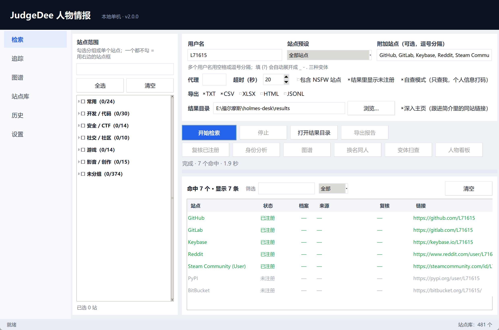

# JudgeDee · local person-intel workbench

> A desktop tool that runs entirely on your own machine. Give it one username and it finds the
> accounts scattered across sites; then it uses the nickname, bio, avatar and cross-links on each
> profile as evidence to decide which of those accounts are actually the same person.

[中文说明](README.md) · [Full manual (EN)](docs/manual.en.md) · [完整手册（中文）](docs/manual.md)



## What it does

- **Account search** — 481 sites, queried concurrently by username, tick sites by group or by name.
- **Person rebuild** — identity clusters, pairwise evidence, an identity graph, a persona board,
  rename suggestions, and a variant sweep that hunts for alternate usernames.
- **Context clues** — IP geolocation (country / city / coordinates / ISP / ASN) and offline phone
  number parsing, which you can attach to a person as clues.
- **Paper trail** — local history, diff between two runs, export to TXT / CSV / XLSX / HTML / JSONL
  (the HTML report embeds an SVG graph).

English and Chinese UI. Switch in **Settings → Language**, then restart.

## Install

**Option 1 — download (no Python needed)**

Grab `JudgeDee.exe` from Releases, put it in a folder of your choice and double-click it. The launcher
finds your Python installation and starts the app; if something fails it writes
`judgedee-launcher.log` next to the exe.

**Option 2 — from source**

```bash
git clone https://github.com/L71615/judgedee.git
cd judgedee
python -m pip install -e .
python -m judgedee
```

Optional extras:

```bash
python -m pip install -e ".[export]"   # XLSX export (pandas + openpyxl)
python -m pip install -e ".[profile]"  # avatar comparison (Pillow)
python -m pip install -e ".[phone]"    # offline phone library (phonenumbers)
```

You do not have to install `phonenumbers` by hand: the Trace page has a **one-click install** button
that fetches it into the app's own config directory (~2.5 MB) without touching your system Python.

## The six pages

### Search

1. Type a username (or several, separated by spaces / commas; `{?}` expands to `_`, `-`, `.` variants).
2. Pick a site preset or type site names; or tick groups / sites in the left tree.
3. Click **Start**.

Four follow-up actions after a run:

| Action | What it gives you |
|---|---|
| Re-verify | Re-checks only the "claimed" rows with a fresh session, flags suspected false positives |
| Analyze identity | Fetches each claimed profile and clusters the accounts into persons A/B/C |
| Graph | Draws the identity graph (drag / zoom / pan, pairwise evidence on the right) |
| Aliases | Suggests "different username, same person" pairs you can merge with one click |
| Variant sweep | Derives username variants from nicknames and runs another pass |
| Persona | Builds the persona board: account count, coverage, merged fields, confidence |

### Identity analysis

Accounts are grouped only when there is real evidence — the same username is a weak hint, not proof.

| Evidence | Weight |
|---|---|
| Avatar similarity (pHash) | 0.35 |
| Nickname similarity | 0.20 |
| Bio word overlap (Jaccard) | 0.20 |
| Mutual cross-links | 0.25 (one-way link 0.20) |
| Site affinity prior | 0.10 |
| Same username | 0.05–0.20 (scaled by how unique the name is) |

Negative evidence: two different avatars −0.40, different nicknames with empty bios −0.15.
Score ≥ 0.62 merges into one person; 0.45–0.62 is listed for you to confirm; below that they stay apart.

With **Deep profile** enabled (default), the app also follows up to 2 same-site links (for example the
repositories tab) and folds that text into the bio used for comparison.

### Graph

Coloured dot = account. The pale circle behind a dot set is one person ("Person A · 2 accounts"); the
bigger the circle, the stronger that group's evidence. Three edge weights: solid navy = strong, grey
solid = needs confirmation, faint dashed = weak. Drag nodes, wheel to zoom, right-drag to pan, double
click to open a profile.

### Trace

- **IP geolocation** — country, region, city, postal code, coordinates, timezone, ISP, organisation,
  ASN, plus mobile / proxy / hosting flags and a map link. Uses `ip-api.com`, falls back to `ipinfo.io`.
- **Phone number** — offline parsing via `phonenumbers`: number type, validity, country, location,
  carrier, timezone, international / local / E.164 formats. The number never leaves your machine.

### Sites

Add your own sites, edit URLs, enable/disable, group them, export and import the table. A site entry
needs: name, URL template (must contain `{}`), how to decide, and the status code or error message.

### History

Every run is stored in a local SQLite file. Select two runs to compare: added / removed / still there.

## Reading the results

| Status | Meaning |
|---|---|
| Claimed | The site has this username |
| Available | No such account |
| Unknown | Response did not match any rule |
| Illegal | Username breaks the site's rules |
| WAF | Blocked by a firewall / captcha page |

## Export

| Format | Notes |
|---|---|
| TXT | Plain list, one line per hit |
| CSV | Raw table |
| XLSX | Needs pandas + openpyxl |
| JSONL | One JSON object per line |
| HTML | Single file report: summary, table, SVG identity graph, rename table, clue table |

## Command line

```bash
python -m judgedee                # GUI
python -m judgedee --selftest     # start and close immediately (smoke test)
python -m judgedee --version
python -m judgedee --install-shortcut
python -m judgedee --remove-shortcut
```

## Privacy and boundaries

- All results stay on your machine: config directory, history SQLite, export folder.
- No account, no upload, no telemetry. Site list, rules and icons ship with the app.
- Only the Trace page talks to the outside world, and only with the IP you typed.
- Self-check mode masks emails / IM handles / personal domains on the persona board; counts and
  conclusions are unchanged.
- Only search accounts you are allowed to look up.

## FAQ

**Double-click does nothing.** Check `judgedee-launcher.log` next to the exe. The launcher writes the
Python path it found and the error output of the app.

**The app opens to an old version.** You are probably running an older exe / shortcut. Delete it and
use the `JudgeDee.exe` from the current release.

**Config directory is not writable.** The app falls back to the folder next to the program, then to a
temp directory; set `JUDGEDEE_HOME` to choose the location yourself (portable mode).

**Phone parsing says the library is missing.** Open Trace → Phone number → **install the phone library**.

## Development

```bash
python -m unittest discover -s tests   # 124 tests
python -m judgedee --selftest
```

```text
judgedee/            engine, profile, identity, graph, traces, export, i18n
  ui/                six pages + dialogs
  data/data.json     481 sites
tests/               unit tests, no network
build/               PyInstaller script, launcher, icon builder
```

## License

MIT — see [LICENSE](LICENSE). Third-party data attributions are listed in [NOTICE](NOTICE).
