# HolmesDesk · 用户名检索（本地桌面版）

> 输入一个用户名，看它在 481 个网站上有没有被注册。
> 纯本地运行，不联网拉站点表、不经过任何第三方服务器，结果直接导出成 TXT / CSV / XLSX / HTML / JSONL。


> 说明：本文所有截图都是拿作者自己的账号 `L71615` 跑的演示数据；截图里的邮箱、IM、
> 个人站点均为示例值（`example.com` 之类），真实联系方式在自查模式下会被打码。

## 这是什么

HolmesDesk 是一个 Windows 桌面小程序：填用户名 → 点开始 → 得到一份「这个人在哪些站有账号」的清单。

它的前身是命令行的 [sherlock](https://github.com/sherlock-project/sherlock)，这个仓库是把那套思路重做成**中文图形界面 + 单机可分发**的版本：

- **不依赖上游 API**：站点表（481 个站）随程序打包，气隙环境也能跑；上游改接口不会让它崩。
- **只依赖 requests**：没有 pandas、没有 browsercookie，装完 10 MB 出头。
- **双击即用**：桌面图标点开就是界面，不用开终端、不用记参数。
- **结果能直接给人看**：HTML 报告是单文件，发给别人双击就能看。

## 快速开始

### 方式一：下载即用（推荐给普通用户）

1. 到 [Releases](https://github.com/L71615/holmes-desk/releases) 下载 `HolmesDesk-win64.zip`
2. 解压到任意目录，双击 `HolmesDesk.exe`
3. 想放桌面就右键 → 发送到 → 桌面快捷方式

免安装、不写注册表；想卸载直接删文件夹（配置在 `%APPDATA%\HolmesDesk\config.json`，也可一并删除）。

### 方式二：从源码装（开发者）

```bash
git clone https://github.com/L71615/holmes-desk.git
cd holmes-desk
python -m pip install -e .

# 打开界面
holmes-desk

# 在桌面和开始菜单创建快捷方式（图标内嵌在 exe 里，不会显示成白纸）
holmes-desk --install-shortcut
```

要求 Python 3.9+（推荐 3.11）。只需要 `requests`。
想导出 XLSX 再装一个可选依赖：`python -m pip install -e ".[export]"`（pandas + openpyxl）。

## 五个页面

左侧导航切换：**检索 / 图谱 / 站点库 / 历史 / 设置**。

### 检索

左栏是站点范围：勾分组（整组一起选）或勾单个站点；一个都不勾就走右边的「附加站点」框，也不填就是全部 481 站。

1. **用户名**：填一个或多个，空格或逗号分隔。填 `{?}` 会自动展开成 `_` `-` `.` 三种变体
   （比如 `john{?}doe` → `john_doe`、`john-doe`、`john.doe`）。
2. **站点预设**：常用 / 开发·代码 / 安全·CTF / 社交·社区 / 游戏影音·创作，选一组省时间。
3. **代理**：程序会自动读取系统代理并探活后填入；不需要代理就清空。
4. **超时**：单站点请求上限，默认 20 秒。网络差就调大。
5. **导出**：勾选的格式会在 `results\<时间戳>\` 下生成每个用户名一份文件。
6. 双击结果行可以直接打开那个主页；上方「筛选」按站点名 / 链接过滤，右边下拉按状态筛（全部 / 已注册 / 未注册 / 未知 / 格式不符 / 被拦截）。
7. **复核已注册**：对「已注册」的行再打一次请求，减少误报（见下）。
8. **身份分析**：抓主页画像、按证据聚类，把「同名不同人」拆开（见下）。
9. **图谱**：把档案摆成一张可拖动的网，还能手动合并 / 拆分（见下）。
10. **换名同人**：列出「用户名不同但证据很像」的组合，点一下就并成同一档案（见下）。
11. **变体扫查**：用已命中账号的昵称派生用户名变体，再跑一轮把散落的号捞回来（见下）。
12. **人物看板**：把账号、档案、类别覆盖、字段合并拼成一屏结论（见下）。
13. **导出报告**：把当前结果（带复核结论、档案和分组）另存一份，跟检索时自动导出的原始结果分开。

快捷键：`Ctrl+Enter` 开始，`Esc` 停止，`F5` 刷新当前页。

### 站点库

表格里是全部站点，可以：

- **搜索 / 按分组筛选**，看某个站现在归在哪一组。
- **编辑**：改中文备注名、改分组（直接输入新名字就是新建分组）、改 URL 模板、改判定方式。
- **启用 / 禁用**：禁用的站点不参与检索，检索页里显示成灰色。
- **恢复内置**：把改过的站点还原成原始定义。
- **删除自定义站点**：只对手动新增的站点有效，内置站点只能禁用、不能删。
- **新增站点**：填名字、URL 模板（必须含 `{}`）、判定方式即可；提交前会校验，写错会直接告诉你哪里不对。
- **导入 / 导出**：站点库可以存成 JSON 带走或分享，也可以导入别人的库（同名站点会被覆盖）。

改动存在 `%APPDATA%\HolmesDesk\sites_user.json`，不碰内置的 `data.json`——所以升级程序不会丢你自己的改动，想全清就删这个文件。

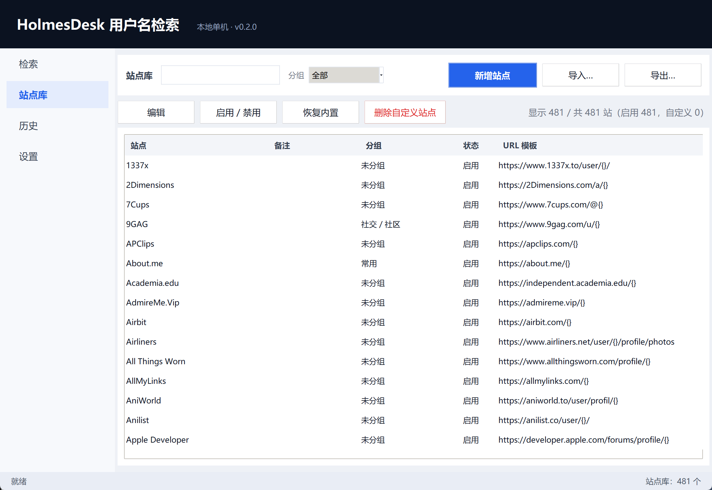

### 复核

一次检索报「已注册」，也可能只是站点把人机验证页、或者「这个用户名不存在」的提示页返回了 200。
点「复核已注册」会对这些行**换一个新会话重打一次**，结论写进「复核」列：

| 复核 | 含义 |
| :-- | :-- |
| 复核通过 | 两次都判为已注册，基本可信 |
| 存疑 | 第一次说在、复核变成不在（或反过来），多半是误报 |
| 未判定 | 复核请求失败（超时/被拦），保持原结论 |

复核是额外一轮请求，站点多的时候会明显变慢，按需点。

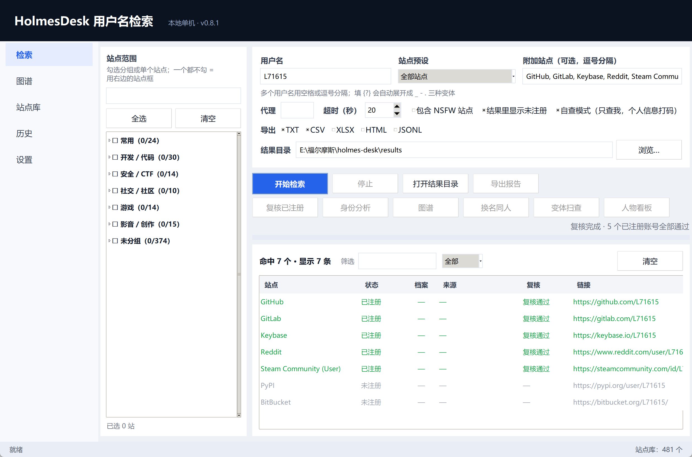

### 身份分析

同名不等于同一个人。检索结果里点「身份分析」，程序会：

1. 抓取每个「已注册」账号的主页（昵称 / 简介 / 头像 / 外链 / 互指的 @用户名）；
2. 对任意两个账号按证据打分；
3. 把证据够硬的归成同一个档案（A / B / C…），写进结果表的「档案」列；
4. 弹出「身份档案」窗口，逐条列出合并理由，以及分数不够、需要你自己判断的组合。

证据怎么加权（缺证据不给分，宁可分开也不硬凑）：

| 证据 | 权重 | 说明 |
| :-- | :-- | :-- |
| 头像相似 | 0.35 | 感知哈希（dHash + aHash）距离，很多人各站用同一张图 |
| 昵称相似 | 0.20 | 归一化后比较，去掉 emoji、大小写、标点 |
| 简介用词重叠 | 0.20 | Jaccard，词太少时不给分 |
| 外链 / 互指 | 0.20 | 共同外链域名，或简介里提到的 `@用户名` |
| 站点相关性 | 0.10 | 同类型站点（如 GitHub 与 PyPI）先验更高 |
| 用户名相同 | 0.05–0.20 | **只作弱证据**，按用户名独特性打折：`alex` 几乎没分，`alex_kovacs_1993` 才给满 |
| 双向互指 | 0.25 | A 提到 B、B 也提到 A，直接算强证据 |
| 负证据 | −0.40 / −0.15 | 头像明显不同；昵称不同且两边都没有简介 |

判定：≥ 0.62 归入同一档案；0.45–0.62 列为「待确认」；低于 0.45 视为不同人。
聚类是层次聚类 + 平均连接（不是单链），所以 A≈B、B≈C 不会自动把 A 和 C 并在一起，
而且每次合并都必须有一条强证据（头像近乎相同 / 互指 / 共同稀有域名）。

头像哈希需要 Pillow：`python -m pip install -e ".[profile]"`。不装也能用，只是少了头像
这条最强证据，合并会更保守。

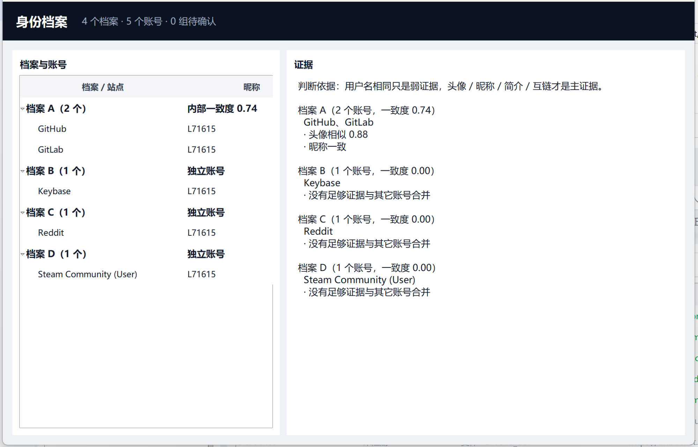

### 图谱

身份分析完成后点「图谱」（或左侧导航「图谱」），账号会摆成一张网：

- 一个圆点是一个账号，圆点颜色表示档案（同色 = 被判为同一个人）；
- 连线是证据：**实线**强证据（头像近乎相同 / 双向互指 / 共同稀有域名），**虚线**弱证据；
- 点一个点，右侧列出它的昵称、简介、链接；点两个点，还会给出这两个账号的综合分和逐条理由；
- 拖动可以挪开重叠的点，滚轮缩放，右键拖动平移，双击打开主页。

同名不等于同人，这张图就是让你**自己**看一眼再决定。判断不对可以直接改：

- 按住 `Ctrl` 点两个点 → 「合并为同一人」（must-link）；
- 或者「标记为不同人」（cannot-link）；
- 这些判断存在 `%APPDATA%\HolmesDesk\constraints.json`，当场重新聚类，下次分析也继续生效，
  想撤销就选回这两个点再点「清除该对约束」。

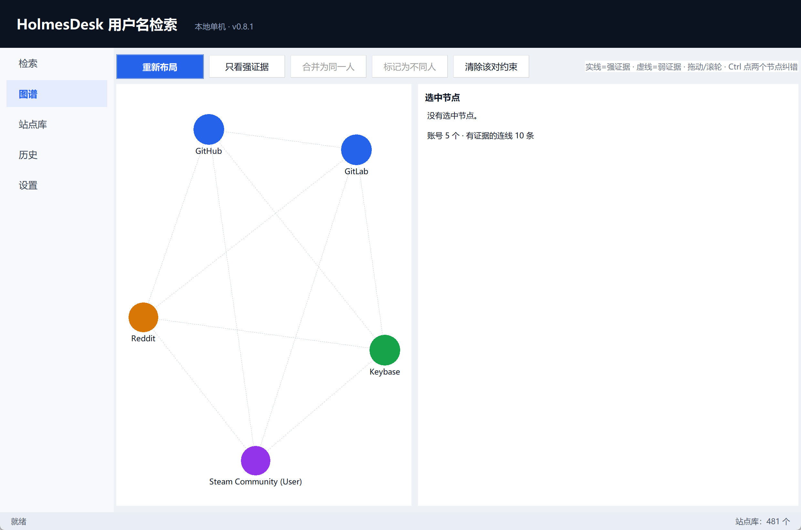

下面是把 GitLab 和 Steam 两个账号手动并成「档案 A」之后的样子（4 个档案，底部状态栏有提示）：

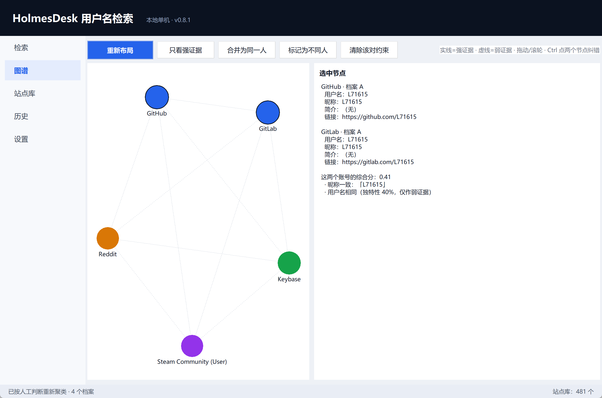

### 历史

每次检索自动落库（SQLite，`%APPDATA%\HolmesDesk\history.db`），记下时间、用户名、命中数、站点数、用时、导出目录。
点一条就能在下表看到那次的具体结果，可以删除单条、清空全部、或直接打开当时的导出目录。

选中一条点「和上一次对比」，会拿它跟**同用户名的上一次检索**（没有就退回归全局上一条）比，
分三栏列出「新增 / 消失 / 仍在」的已注册账号——查一个人隔了三周有没有多注册几个站，看这个就够。

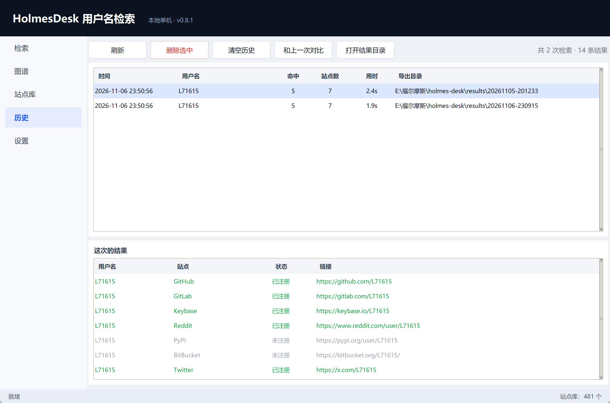

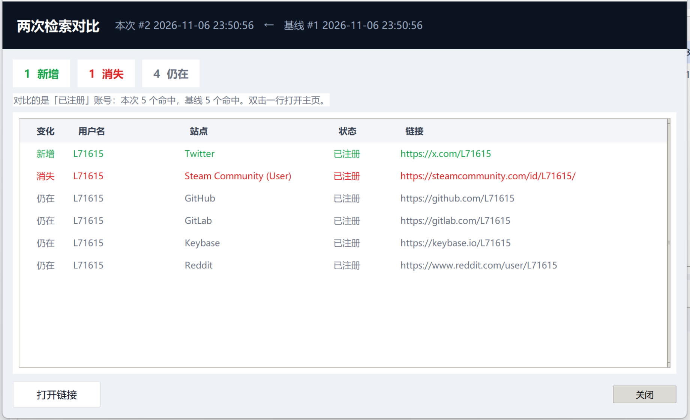

### 换名同人

分析完还会算一遍「用户名不同、但证据很像」的组合（证据分 ≥ 0.45）。检索页点「换名同人（N）」：

- 每一行是「账号 A / 账号 B / 证据分 / 理由」；
- 选中一行点「合并为同一人」，会写进 `constraints.json` 的 must-link 并立即重新聚类，
  两个不同用户名就正式并成一个档案（图谱颜色跟着变）；
- 不想并就关掉窗口，这个建议不会自己生效——聚类始终以「用户名相同」为前提。

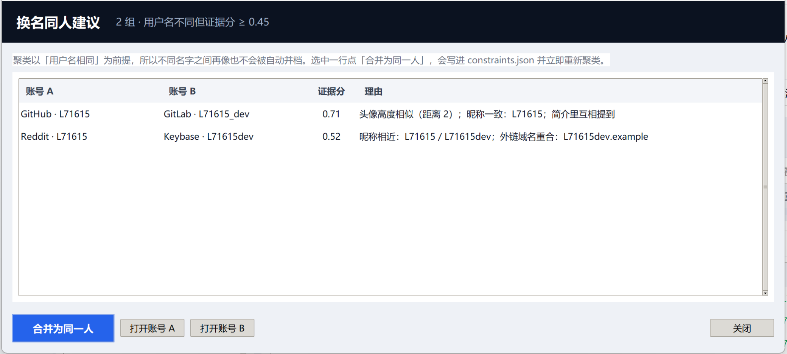

### 变体扫查

真实的人不会在每个站都用同一个 ID：`sherlock`、`crazy_sherlock`、`s.dyke` 很可能是一个人。
「变体扫查」就是把这层猜测变成下一轮检索：

- 从**已命中账号的昵称**（不是用户名）生成候选：拆分名字与姓氏的顺序、换分隔符（`.` `_` `-` `空`）、
  首字母缩写、名字 + 姓氏首字母等，一次最多取 12 个；
- 每个变体都会跑一遍当前勾选的站点，新命中的账号并进同一张结果表，**「来源」列**标出它是从哪个变体来的；
- 跑完自动重新做一次身份分析，新账号会被纳入聚类和图谱。

中文昵称不会硬翻拼音（免得生成一堆无意义的候选），只处理拉丁字母的名字。
网络开销是「变体数 × 站点数」，所以默认上限 12 个变体，开始前会弹窗确认。

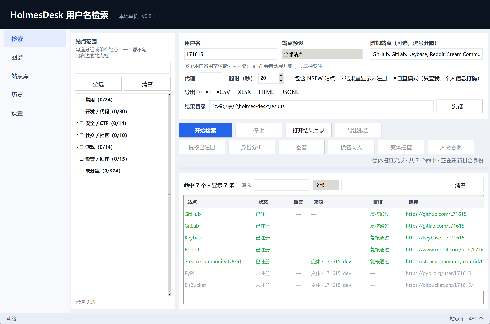

### 人物看板

「一共注册了多少个」这句话，正确的说法有两层：**账号数**和**人数**。
做完身份分析点「人物看板」，一屏给出：

- **数量关系**：5 个账号 → 3 个档案（其中 1 个是合并来的）、多少组待确认、抓到了几种头像；
- **一句话结论**：可直接复制进报告的一段话；
- **类别覆盖**：开发 / 社交 / 创作 / 游戏 / 其他，命中几类、每类具体是哪几个站。
  空掉的类别本身就是线索——「有 Telegram 没有 Twitter」和「哪儿都没有」是两种人；
- **字段合并**：昵称、邮箱、即时通讯、个人站点，多站来源计数（出现 2 次以上的会标出来）；
- **各站说法不一致**：同一个字段出现多个取值时并排显示，不替你选；
- **可信度 0–100**：档案内部一致度占七成、类别覆盖占三成。

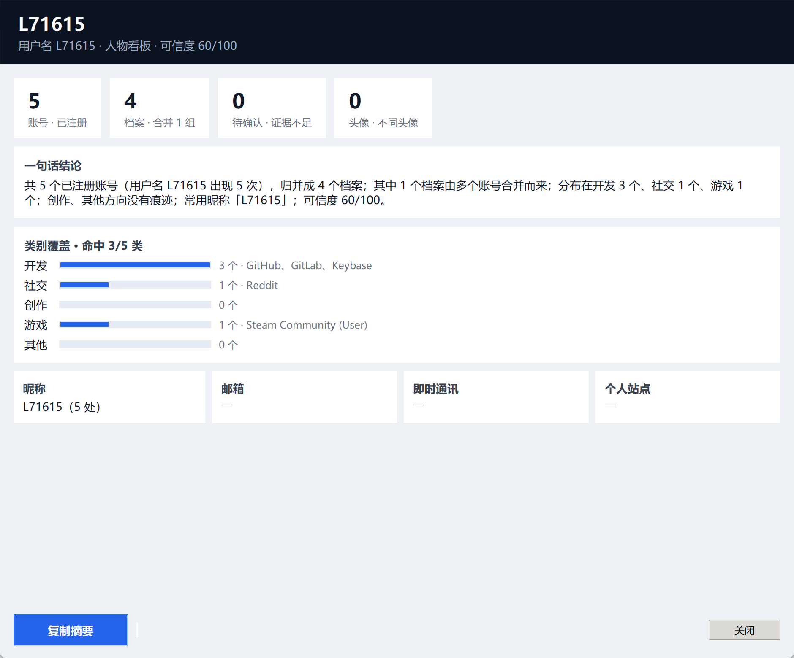

### 自查模式

这个工具默认是用来查**已公开的账号**的。如果你只想查自己，勾检索页的「自查模式」：

- 用户名会自动换成设置页里「我的用户名」填的那个，不用每次手打；
- **人物看板里的个人信息会打码**：邮箱只留前两位（`al***@ex***.com`）、IM 只留前缀
  （`Telegram: al***`）、自建域名打码（`al***.dev`，gmail 这类公共邮箱域名保留）；
- 打码只影响展示，**账号数、档案数、类别覆盖、可信度这些结论完全不变**；
- 设置页里可以把它设成默认开启；想恢复正常显示，取消勾选即可。

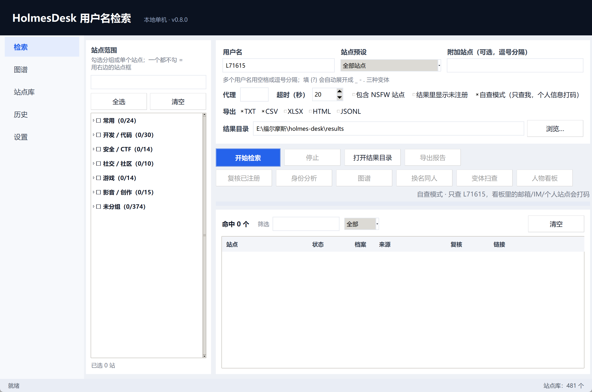

打码之后的人物看板（注意邮箱和站点域名，其余结论照旧）：

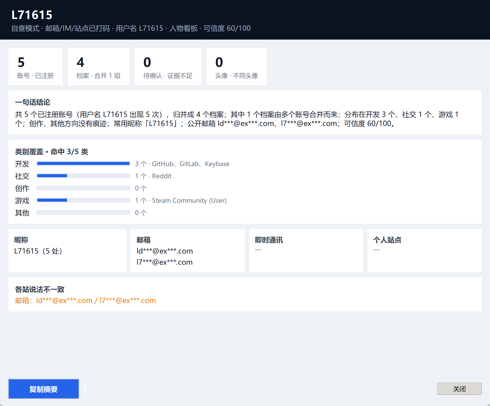

### 设置

改默认代理、超时、结果目录、默认导出格式、NSFW / 显示未注册的默认开关；
也能看到数据文件的实际位置、一键打开配置目录、清空历史。

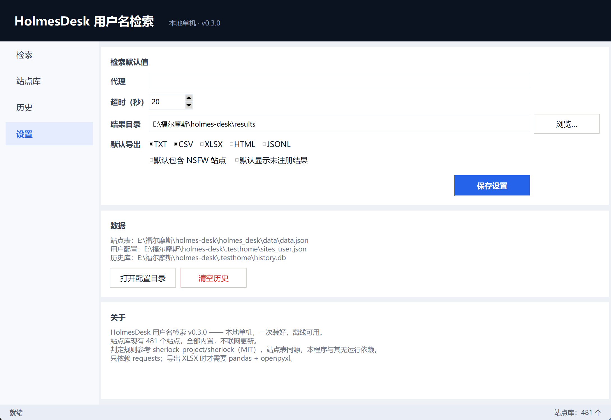

## 结果怎么看

| 状态 | 含义 |
| :-- | :-- |
| **已注册** | 该站返回正常页面，账号存在 |
| **未注册** | 站点明确返回「没有这个人」（404 / 错误提示语命中） |
| **未知** | 超时、被拦、返回内容既不像存在也不像不存在——**不要当成没有** |
| **格式不符** | 用户名不满足该站的规则（如只允许字母数字），本地直接跳过，没发请求 |
| **被拦截** | 命中 WAF / 人机验证页面，结论不可信 |

默认只显示「已注册」；勾选「结果里显示未注册」可以看到全部结论。

## 导出格式

检索时按勾选的格式自动落盘；点「导出报告」则会额外出一份带上复核结论、按分组归类的版本。

| 格式 | 用途 |
| :-- | :-- |
| TXT | 纯链接清单，贴到别处最省事（报告版会在行尾标注复核结论） |
| CSV | 进 Excel / 数据库（报告版多 `group` 和 `verdict` 两列） |
| XLSX | 带表头的表格（需要 pandas + openpyxl） |
| HTML | 单文件报告，含状态色标、统计、**身份图谱**，可直接发给别人 |
| JSONL | 每行一个 JSON，方便脚本继续处理 |

检索导出字段：`username, site, url_main, url_user, exists, http_status, response_time_s`。
报告导出字段：`username, site, group, status, identity, verdict, url_user, http_status, response_time_s`。

### HTML 报告里的图谱

如果先做过身份分析再导出报告，HTML 会多两块内容（`docs/sample-report/sherlock.html` 是个真实样例）：

1. **身份图谱**：SVG 画的账号关系图，圆点颜色 = 档案，实线强证据 / 虚线弱证据；
   鼠标移到点上是高亮它的连线，点一下弹出昵称、简介、链接。纯 SVG + 二十来行原生 JS，
   没有 CDN、没有框架，离线双击就能看。
2. **可能是同一个人的不同用户名**：聚类以「用户名相同」为前提，不同名字之间再像也不会
   自动并档，所以单独列一张表提醒你——账号 A、账号 B、证据分、理由。

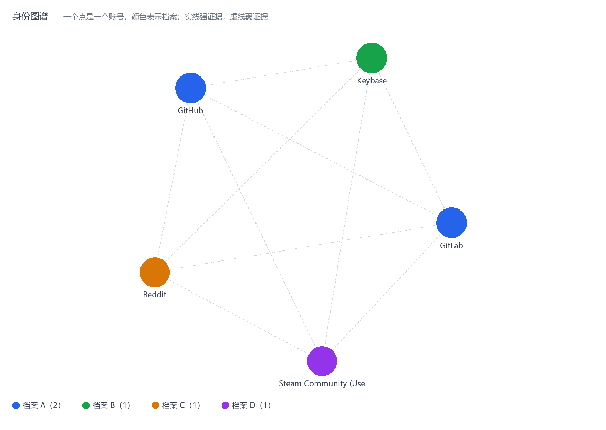

## 命令行用法

不开界面也能跑，方便写成脚本：

```bash
holmes-desk --search sherlock --sites GitHub,Reddit,GitLab --proxy http://127.0.0.1:7897
holmes-desk --search alice --all          # 连未注册的站点一起打印
```

其它参数：`--version`、`--selftest`（启动界面后自动关闭，用来查能不能打开）、
`--install-shortcut`、`--remove-shortcut`。

## 打包成 exe

```powershell
pwsh -File build\build.ps1
# 产物：dist\HolmesDesk.exe（单文件、带图标）
```

## 自定义站点表

站点表在 `holmes_desk/data/data.json`，格式与上游一致：

```json
"GitHub": {
  "url": "https://www.github.com/{}",
  "urlMain": "https://www.github.com/",
  "errorType": "status_code"
}
```

常用字段：

- `url`：用 `{}` 代入用户名
- `urlMain`：站点首页
- `errorType`：判定方式，`status_code` / `message` / `response_url`
- `errorMsg`：`message` 型用来判断「不存在」的提示语（字符串或字符串数组）
- `errorCode`：`status_code` 型里代表「不存在」的状态码
- `regexCheck`：用户名必须匹配的正则，不匹配直接判为「格式不符」
- `urlProbe`：探测用地址（与展示地址不同的站点）
- `request_method` / `request_payload`：POST 型站点用
- `isNSFW`：是否成人站点，勾选后才参与检索

改完重启程序即可，无需重新打包（源码模式下）。

## 和上游 sherlock 的关系

数据与思路来自 [sherlock](https://github.com/sherlock-project/sherlock)（MIT），
界面、引擎、导出、打包全部重写，运行时不依赖也不调用上游任何服务。
详见 [NOTICE](NOTICE)。

## 隐私

- 所有请求从你本机直接发往目标站点，程序不收集、不上传任何数据。
- 唯一的「外联」是检索本身，以及 `--install-shortcut` 时调用本机 PowerShell 建快捷方式。
- 配置和历史只存在本机 `%APPDATA%\HolmesDesk\`。

## 注意

这是给人自查用的工具：查自己的用户名、看自己的账号暴露面。
批量扫描他人、绕过速率限制之类的用法不在设计范围内，请自行判断合规性。
站点随时会改结构，出现「未知」很正常。

## 开发

```bash
python -m pip install -e ".[export,build]"
python -m holmes_desk --selftest     # 2 秒后自动关窗
python -m holmes_desk --search sherlock --sites GitHub,Reddit
```

目录结构：

```
holmes_desk/
  engine.py        检索引擎（并发、判定、{?} 展开、可中断）
  sitelib.py       站点库：分组 / 中文名 / 启用禁用 / 自定义 / 导入导出
  verify.py        已注册结果二次复核
  profile.py       主页画像采集（昵称 / 简介 / 头像哈希）
  identity.py      证据打分与身份聚类（同名≠同人）
  history.py       本地历史（SQLite）
  export.py        TXT/CSV/XLSX/HTML/JSONL 导出
  config.py        %APPDATA%\HolmesDesk\config.json 读写
  presets.py       站点预设分组
  platform_win.py  DPI、系统代理、桌面快捷方式
  paths.py         资源路径（兼容 PyInstaller）
  data/data.json   481 个站点
  ui/app.py        Shell 主窗口 + 左侧导航
  ui/page_search.py   检索页
  ui/dialog_identity.py 身份档案窗口（证据视图）
  ui/page_sites.py    站点库页
  ui/page_history.py  历史页
  ui/page_settings.py 设置页
  ui/theme.py      配色与 ttk 样式
build/             打包脚本、图标生成、启动器源码
tests/             单元测试（python -m unittest discover -s tests）
```

便携模式：设环境变量 `HOLMES_DESK_HOME=<目录>`，配置、站点库、历史都会写到那个目录下，
不碰 `%APPDATA%`（U 盘或测试环境用）。

## 许可证

MIT，见 [LICENSE](LICENSE)。站点数据来自 sherlock（MIT），见 [NOTICE](NOTICE)。
