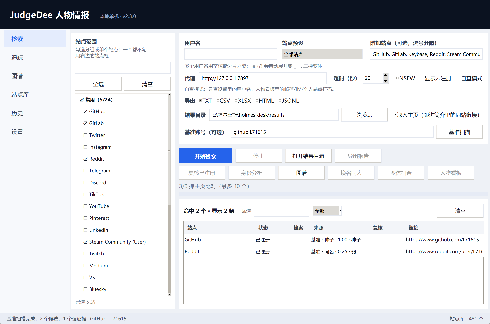
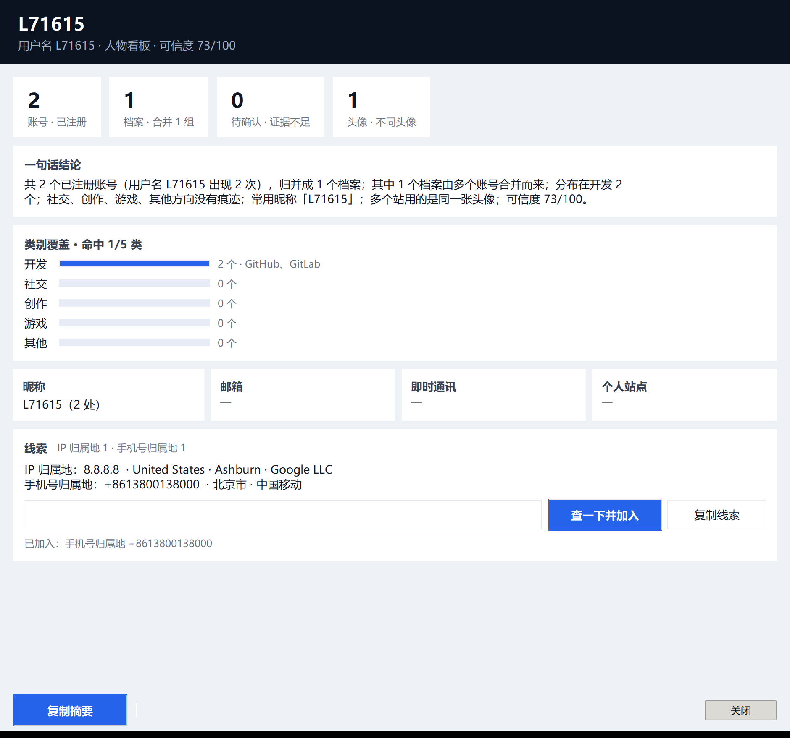
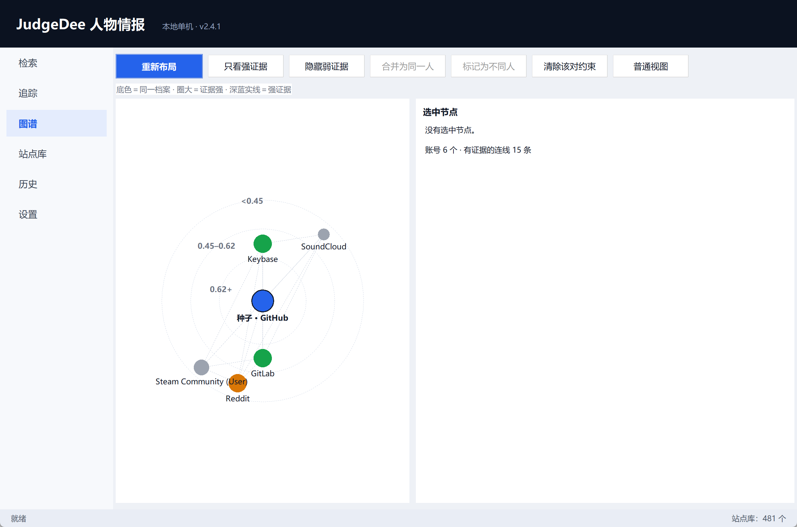

# JudgeDee · 本地人物情报工作台

给一个用户名，看它在 481 个网站上有没有被注册；再顺着主页证据把散落的账号拼成「一个人」。
另外带 IP 归属地和手机号解析。**全部在本机跑**：站点表随程序分发，检索直连目标站点，不经过任何中转。

[English](README.en.md) · [完整手册](docs/manual.md) · [Full manual (EN)](docs/manual.en.md)

界面支持中英文，在「设置 → 语言」切换后重启生效。


## 能做什么

- **账号检索**：一个或多个用户名，并发查 481 个站点，结果给链接、状态、HTTP 码、耗时。
- **人物重建**：抓主页的昵称 / 简介 / 头像 / 互链当证据，判断哪几个账号是同一个人，输出档案 + 证据 + 可信度。
- **周边线索**：IP 归属地（国家、城市、经纬度、ISP、ASN、代理/机房标记）、手机号离线解析。
- **留痕与交付**：本地历史、两次检索对比、TXT / CSV / XLSX / HTML / JSONL 导出，HTML 报告内嵌 SVG 图谱。

## 安装

**普通用户**：到 [Releases](https://github.com/L71615/judgedee/releases) 下载 `JudgeDee-win64.zip`，
解压后双击 `JudgeDee.exe`。免安装、不写注册表，删文件夹即卸载。

**从源码**：

```bash
git clone https://github.com/L71615/judgedee.git
cd judgedee
python -m pip install -e .
python -m judgedee --install-shortcut   # 在桌面和开始菜单建带图标的快捷方式
python -m judgedee                      # 打开界面
```

Python 3.9+（推荐 3.11），必装只有 `requests`。
可选：`".[export]"`（XLSX）、`".[profile]"`（头像比对）、`".[phone]"`（手机号解析）、`".[all]"`（全装）。

## 六个页面

左侧导航切换：**检索 / 追踪 / 图谱 / 站点库 / 历史 / 设置**。

### 检索

左栏是站点范围：勾分组（整组一起选）或勾单个站点；一个都不勾就走右边的「附加站点」框，也不填就是全部 481 站。

1. 填**用户名**，空格或逗号分隔。填 `{?}` 会展开成 `_` `-` `.` 三种变体（`john{?}doe` → `john_doe`、`john-doe`、`john.doe`）。
2. **站点预设**：常用 / 开发·代码 / 安全·CTF / 社交·社区 / 游戏影音·创作，选一组省时间。
3. **代理**：自动读系统代理并探活后填入；不需要就清空。
4. **超时**：单站点请求上限，默认 20 秒，网络差就调大。
5. 点「开始检索」；双击结果行打开主页，上方「筛选」按站点名 / 链接过滤，右边下拉按状态筛。

结果出来之后还有四个动作，都在这条工具条上：

- **复核已注册**：用独立请求把已注册项重查一遍，标「复核通过 / 存疑」，压掉误报。
- **身份分析**：抓每个账号的主页，聚类成档案（详见下节）。
- **变体扫查**：从已命中账号的昵称生成用户名变体（换分隔符、首字母、姓名倒序），再跑一轮，结果「来源」列标 `变体 · xxx`。
- **导出报告**：出一份带复核结论、按分组归类的报告，HTML 版还带图谱。

### 基准账号扫描（从"确定是本人"的那个账号出发）

检索回答的是「这个名字在哪些站存在」；基准扫描多一个前提——**其中一个是本人**。
在「基准账号」框填 `github L71615`（也接受 `https://github.com/L71615` 或纯用户名），点「基准扫描」：



| 步骤 | 做什么 |
| :-- | :-- |
| 1. 种子 | 抓这个账号的主页，拿到昵称、简介、头像 |
| 2. 同名 | 在当前站点范围里查同名账号 |
| 3. 变体 | 从昵称派生用户名变体（`Alice Zhang` → `alicezhang`、`a_zhang`），再查一轮 |
| 4. 比对 | 每个候选和种子比头像 / 昵称 / 简介 / 互链，给出 0–1 的证据分 |

结果表「来源」列会写成 `基准 · 同名 · 0.83 · 强`，分数越高越像同一个人：
≥ 0.62 强候选，0.45–0.62 待确认，再低就是「只是同名」。分数 ≥ 0.45 的可以直接继续「身份分析」，进档案。

检索功能本身完全没变：不填基准账号，一切和以前一样。

### 身份分析（拼人）

点「身份分析」后按证据打分，不是按用户名硬凑——**同名 ≠ 同人**：

| 证据 | 权重 | 说明 |
| :-- | :-- | :-- |
| 头像相似 | 0.35 | 抓主页头像算 aHash / dHash，比对汉明距离 |
| 昵称相似 | 0.20 | 显示名归一化后比对 |
| 简介词重叠 | 0.20 | 简介取词做 Jaccard |
| 互链 | 0.20 / 0.25 | 两边互指时另计「互相提到」加成 |
| 站点相关性 | 0.10 | 同类型站点先验 |
| 用户名相同 | 0.05–0.20 | 只看独特性，`l71615` 这种越独特权重越高 |

≥ 0.62 自动并档，0.45–0.62 列为「待确认」，其余视为不同人。
负证据也会扣分：两边头像明显不同 −0.40，昵称不同且简介为空 −0.15。

界面上还会给出：档案表（A/B/C + 内部一致度）、证据清单、两两对比分数。
不满意就自己改：**图谱**页 Ctrl 点选两个节点，「合并为同一人」或「标记为不同人」，
写进 `constraints.json`，下次聚类直接生效。

勾选「深入主页」时，还会跟进主页里指向本人的同站链接（如 `?tab=repositories`），
把正文并入简介参与比对，最多跟进 2 页。

### 图谱

彩色圆点 = 账号，圆点下面那块浅色圆＝同一个档案（上方标着「档案 A · 2 个账号」），
圆越大说明这组账号的证据越硬。连线分三档：深蓝实线是强证据，灰实线是待确认，浅虚线是弱证据。
可拖动节点、滚轮缩放、右键平移，双击打开主页，右边列出选中节点的主页信息与两两证据。


### 追踪

两个标签页，各自占满整宽：**IP 归属地** 与 **手机号归属地**。

**IP 归属地**：国、省/州、城市、邮编、经纬度、时区、ISP、组织、ASN，外加「移动网络 / 代理 VPN / 机房」三个标记，
可一键打开地图。「我的 IP」会先查出你的出口 IP 再接着查归属地。数据源 ip-api.com，失败自动退 ipinfo.io。

**手机号解析**：号码类型、是否有效、国家地区、归属地、运营商、时区，国际 / 本地 / E.164 三种格式。
用 phonenumbers 离线库，**号码不出本机**。首次使用点一下「一键安装号码库（约 2.5 MB）」即可——
装到程序配置目录，不碰系统 Python，装完立刻能用；打包版已内置，无需任何操作。

### 线索卡

人物看板最下面一张卡：把主页里抽到的邮箱、即时通讯、个人站点列在一起，
再贴一个 IP 或手机号进去，直接调追踪页那套查询，结果并进同一张卡。



导出 HTML 报告时线索表会一起写进报告，和身份图谱、换名同人表并列——
「这个人用什么邮箱、挂在哪台服务器上」就不用在几个页面之间来回对照了。

### 站点库

表格列出 481 个站点，可搜索、按分组过滤；支持改中文备注名、改分组、改 URL 模板、改判定方式、
启用/禁用、恢复内置、删除自定义站点、导入导出 JSON。新增站点提交前会校验（URL 必须含 `{}`、判定方式合法）。

### 历史

每次检索自动入库（SQLite），记录时间、用户名、命中数、站点数、耗时、导出目录；
选中一条可看当次结果，或点「和上一次对比」看新增 / 消失 / 仍在。

### 锚定视图

跑完基准扫描后，图谱会自动变成以种子为中心的同心圆：



- 中心是种子账号（标签写着「种子 · GitHub」）；
- 内圈 ≥0.62：几乎可以认定是同一个人；中圈 0.45–0.62：值得看一眼；外圈 <0.45：只是同名；
- 颜色也跟着证据走：蓝=种子、绿=强、橙=待确认、灰=弱；
- 工具条「锚定视图 / 普通视图」可以随时切回按档案分组的样子。

## 结果怎么看

| 状态 | 含义 |
| :-- | :-- |
| **已注册** | 该站返回正常页面，账号存在 |
| **未注册** | 站点明确返回「没有这个人」（404 / 错误提示语命中） |
| **未知** | 超时、被拦、返回内容既不像存在也不像不存在——**不要当成没有** |
| **格式不符** | 用户名不满足该站规则（如只允许字母数字），本地跳过，没发请求 |
| **被拦截** | 命中 WAF / 人机验证页面，结论不可信 |

默认只显示「已注册」；勾选「结果里显示未注册」看全部。

## 导出

| 格式 | 用途 |
| :-- | :-- |
| TXT | 纯链接清单，贴到别处最省事（报告版行尾带复核结论） |
| CSV | 进 Excel / 数据库（报告版多 `group`、`verdict` 两列） |
| XLSX | 带表头的表格（需 pandas + openpyxl） |
| HTML | 单文件报告：状态色标、统计、**身份图谱**，直接发人 |
| JSONL | 每行一个 JSON，方便脚本继续处理 |

检索导出字段：`username, site, url_main, url_user, exists, http_status, response_time_s`。
报告字段：`username, site, group, status, identity, verdict, url_user, http_status, response_time_s`。

先做过身份分析再导 HTML，报告里会多两块：SVG 图谱（悬停高亮连线、点击看详情，离线可看），
以及「可能是同一个人的不同用户名」表（账号 A、账号 B、证据分、理由）。

## 命令行

不开界面也能跑：

```bash
judgedee --search L71615 --sites GitHub,Reddit,GitLab --proxy http://127.0.0.1:7897
judgedee --search alice --all          # 连未注册的站点一起打印
```

其它参数：`--version`、`--selftest`（启动界面后自动关闭）、`--install-shortcut`、`--remove-shortcut`。

## 自定义站点表

`judgedee/data/data.json` 是站点表，键为站点名，值支持：

- `url`：主页模板，用 `{}` 占位
- `urlMain`：站点首页（展示用）
- `errorType`：`status_code`（看 HTTP 码）/ `message`（找错误提示语）/ `response_url`（看跳转后地址）
- `errorMsg` / `errorCode`：配合上一条使用
- `urlProbe`：探测用地址（与展示地址不同的站点）
- `request_method` / `request_payload`：POST 型站点用
- `isNSFW`：是否成人站点，勾选后才参与检索

改完重启即可，源码模式下不用重新打包。

## 打包成 exe

```powershell
pwsh -File build\build.ps1
# 产物：dist\JudgeDee.exe（单文件、带图标）
```

## 隐私与边界

- 结果只写本机：配置与历史在 `%APPDATA%\JudgeDee\`（不可写时自动退到程序目录或临时目录）。
- 检索请求从你本机直接发往目标站点；IP 查询会把被查 IP 发给 ip-api.com（失败退 ipinfo.io）；手机号解析完全离线。
- 自查模式下，人物看板里的邮箱 / IM / 个人站点会打码显示，账号数与结论不变。
- 定位是自查与公开信息整理：查自己的暴露面、查公开账号。批量扫人、绕过限流不在设计范围内。

## 常见问题

**双击没反应 / 打开的是旧界面**
图标要指向 `JudgeDee.exe`（启动器）。失败原因写在程序目录的 `judgedee-launcher.log`，也会弹窗提示。

**配置目录没写权限**
程序按 `%APPDATA%` → `%LOCALAPPDATA%` → 程序目录 → 临时目录 顺序找可写位置，状态栏会说明换到了哪。
想固定就设 `JUDGEDEE_HOME=D:\JudgeDee`。

**某站一直是「未知」**
站点改版了。到「站点库」编辑该站的判定方式，或先禁用它。

**站点数量能扩吗**
能。站点库里「新增站点」，或直接改 `data.json`、导入 JSON 都行。

## 开发

```bash
python -m unittest discover -s tests   # 101 例
python -m judgedee --selftest          # 开窗自检，2 秒后自动关
```

目录结构：

```
judgedee/
  engine.py      检索引擎（并发、判定、{?} 展开、可中断）
  sitelib.py     站点库（分组 / 备注 / 启用禁用 / 自定义 / 导入导出）
  verify.py      已注册结果二次复核
  profile.py     主页画像采集（昵称 / 简介 / 头像哈希 / 跟进同站链接）
  identity.py    证据打分与身份聚类
  graph.py       图谱布局（分簇环形 + 力导向兜底）
  persona.py     人物看板（字段合并、类别覆盖、可信度）
  variants.py    用户名变体生成
  trace.py       IP 归属地与手机号解析
  history.py     本地历史（SQLite）
  export.py      TXT/CSV/XLSX/HTML/JSONL 导出
  config.py      %APPDATA%\JudgeDee\config.json 读写
  ui/            六个页面与各对话框
  data/data.json 481 个站点
build/           打包脚本、图标生成、启动器源码
tests/           单元测试
```

便携模式：设 `JUDGEDEE_HOME=<目录>`，配置、站点库、历史都写到那里，不碰 `%APPDATA%`。

更细的逐页说明、字段表与打包步骤：[docs/manual.md](docs/manual.md)。

## 许可

MIT，见 [LICENSE](LICENSE)；第三方数据的归属声明见 [NOTICE](NOTICE)。
