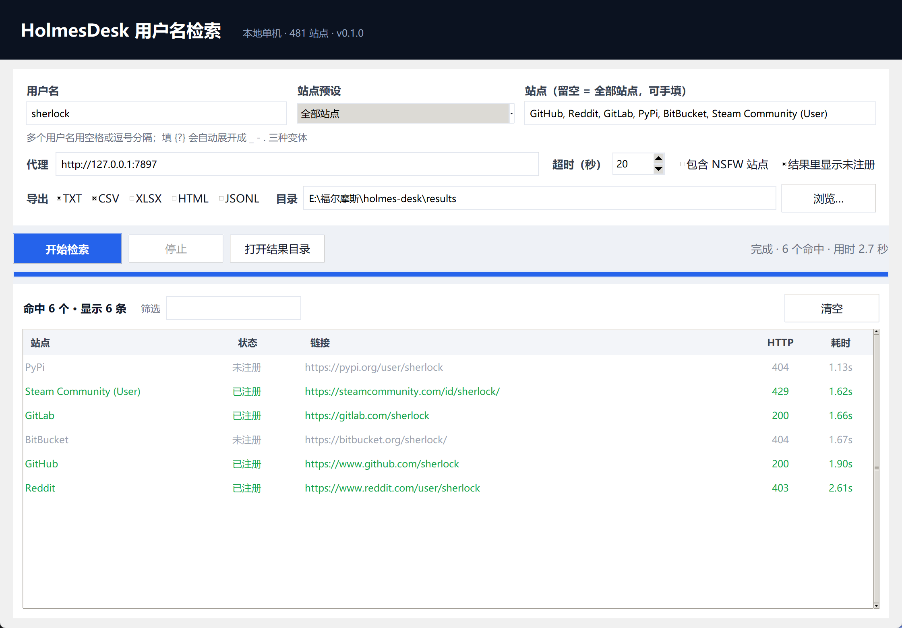

# HolmesDesk · 用户名检索（本地桌面版）

> 输入一个用户名，看它在 481 个网站上有没有被注册。
> 纯本地运行，不联网拉站点表、不经过任何第三方服务器，结果直接导出成 TXT / CSV / XLSX / HTML / JSONL。



## 这是什么

HolmesDesk 是一个 Windows 桌面小程序：填用户名 → 点开始 → 得到一份「这个人在哪些站有账号」的清单。

它的前身是命令行的 [sherlock](https://github.com/sherlock-project/sherlock)，这个仓库是把那套思路重做成**中文图形界面 + 单机可分发**的版本：

- **不依赖上游 API**：站点表（481 个站）随程序打包，气隙环境也能跑；上游改接口不会让它崩。
- **只依赖 requests**：没有 pandas、没有 browsercookie，装完 10 MB 出头。
- **双击即用**：桌面图标点开就是界面，不用开终端、不用记参数。
- **结果能直接给人看**：HTML 报告是单文件，发给别人双击就能看。

## 快速开始

### 方式一：下载即用（推荐给普通用户）

1. 到 [Releases](https://github.com/L71615/holmes-desk/releases) 下载 `HolmesDesk-win64.zip`
2. 解压到任意目录，双击 `HolmesDesk.exe`
3. 想放桌面就右键 → 发送到 → 桌面快捷方式

免安装、不写注册表；想卸载直接删文件夹（配置在 `%APPDATA%\HolmesDesk\config.json`，也可一并删除）。

### 方式二：从源码装（开发者）

```bash
git clone https://github.com/L71615/holmes-desk.git
cd holmes-desk
python -m pip install -e .

# 打开界面
holmes-desk

# 在桌面和开始菜单创建快捷方式（图标内嵌在 exe 里，不会显示成白纸）
holmes-desk --install-shortcut
```

要求 Python 3.9+（推荐 3.11）。只需要 `requests`。
想导出 XLSX 再装一个可选依赖：`python -m pip install -e ".[export]"`（pandas + openpyxl）。

## 怎么用

1. **用户名**：填一个或多个，空格或逗号分隔。填 `{?}` 会自动展开成 `_` `-` `.` 三种变体
   （比如 `john{?}doe` → `john_doe`、`john-doe`、`john.doe`）。
2. **站点预设**：常用 / 开发 / 安全 / 社交 / 游戏 / 影音，选一组省时间；留空则是全部 481 个站。
3. **站点**：想自己指定就手填，逗号分隔，名字要和站点表一致（大小写不敏感），
   例如 `GitHub, Reddit, Steam Community (User)`。
4. **代理**：程序会自动读取系统代理并探活后填入；不需要代理就清空。
5. **超时**：单站点请求上限，默认 20 秒。网络差就调大。
6. **导出**：勾选的格式会在 `results\<时间戳>\` 下生成每个用户名一份文件。
7. 双击结果行可以直接打开那个主页；上方筛选框按站点名 / 链接过滤。

快捷键：`Ctrl+Enter` 开始，`Esc` 停止。

## 结果怎么看

| 状态 | 含义 |
| :-- | :-- |
| **已注册** | 该站返回正常页面，账号存在 |
| **未注册** | 站点明确返回「没有这个人」（404 / 错误提示语命中） |
| **未知** | 超时、被拦、返回内容既不像存在也不像不存在——**不要当成没有** |
| **格式不符** | 用户名不满足该站的规则（如只允许字母数字），本地直接跳过，没发请求 |
| **被拦截** | 命中 WAF / 人机验证页面，结论不可信 |

默认只显示「已注册」；勾选「结果里显示未注册」可以看到全部结论。

## 导出格式

| 格式 | 用途 |
| :-- | :-- |
| TXT | 纯链接清单，贴到别处最省事 |
| CSV | 进 Excel / 数据库 |
| XLSX | 带表头的表格（需要 pandas + openpyxl） |
| HTML | 单文件报告，含状态色标与统计，可直接发给别人 |
| JSONL | 每行一个 JSON，方便脚本继续处理 |

字段：`username, site, url_main, url_user, exists, http_status, response_time_s`。

## 命令行用法

不开界面也能跑，方便写成脚本：

```bash
holmes-desk --search sherlock --sites GitHub,Reddit,GitLab --proxy http://127.0.0.1:7897
holmes-desk --search alice --all          # 连未注册的站点一起打印
```

其它参数：`--version`、`--selftest`（启动界面后自动关闭，用来查能不能打开）、
`--install-shortcut`、`--remove-shortcut`。

## 打包成 exe

```powershell
pwsh -File build\build.ps1
# 产物：dist\HolmesDesk.exe（单文件、带图标）
```

## 自定义站点表

站点表在 `holmes_desk/data/data.json`，格式与上游一致：

```json
"GitHub": {
  "url": "https://www.github.com/{}",
  "urlMain": "https://www.github.com/",
  "errorType": "status_code"
}
```

常用字段：

- `url`：用 `{}` 代入用户名
- `urlMain`：站点首页
- `errorType`：判定方式，`status_code` / `message` / `response_url`
- `errorMsg`：`message` 型用来判断「不存在」的提示语（字符串或字符串数组）
- `errorCode`：`status_code` 型里代表「不存在」的状态码
- `regexCheck`：用户名必须匹配的正则，不匹配直接判为「格式不符」
- `urlProbe`：探测用地址（与展示地址不同的站点）
- `request_method` / `request_payload`：POST 型站点用
- `isNSFW`：是否成人站点，勾选后才参与检索

改完重启程序即可，无需重新打包（源码模式下）。

## 和上游 sherlock 的关系

数据与思路来自 [sherlock](https://github.com/sherlock-project/sherlock)（MIT），
界面、引擎、导出、打包全部重写，运行时不依赖也不调用上游任何服务。
详见 [NOTICE](NOTICE)。

## 隐私

- 所有请求从你本机直接发往目标站点，程序不收集、不上传任何数据。
- 唯一的「外联」是检索本身，以及 `--install-shortcut` 时调用本机 PowerShell 建快捷方式。
- 配置和历史只存在本机 `%APPDATA%\HolmesDesk\`。

## 注意

这是给人自查用的工具：查自己的用户名、看自己的账号暴露面。
批量扫描他人、绕过速率限制之类的用法不在设计范围内，请自行判断合规性。
站点随时会改结构，出现「未知」很正常。

## 开发

```bash
python -m pip install -e ".[export,build]"
python -m holmes_desk --selftest     # 2 秒后自动关窗
python -m holmes_desk --search sherlock --sites GitHub,Reddit
```

目录结构：

```
holmes_desk/
  engine.py        检索引擎（并发、判定、{?} 展开）
  export.py        TXT/CSV/XLSX/HTML/JSONL 导出
  config.py        %APPDATA%\HolmesDesk\config.json 读写
  presets.py       站点预设分组
  platform_win.py  DPI、系统代理、桌面快捷方式
  paths.py         资源路径（兼容 PyInstaller）
  data/data.json   481 个站点
  ui/app.py        主窗口
  ui/theme.py      配色与 ttk 样式
build/             打包脚本、图标生成、启动器源码
```

## 许可证

MIT，见 [LICENSE](LICENSE)。站点数据来自 sherlock（MIT），见 [NOTICE](NOTICE)。
